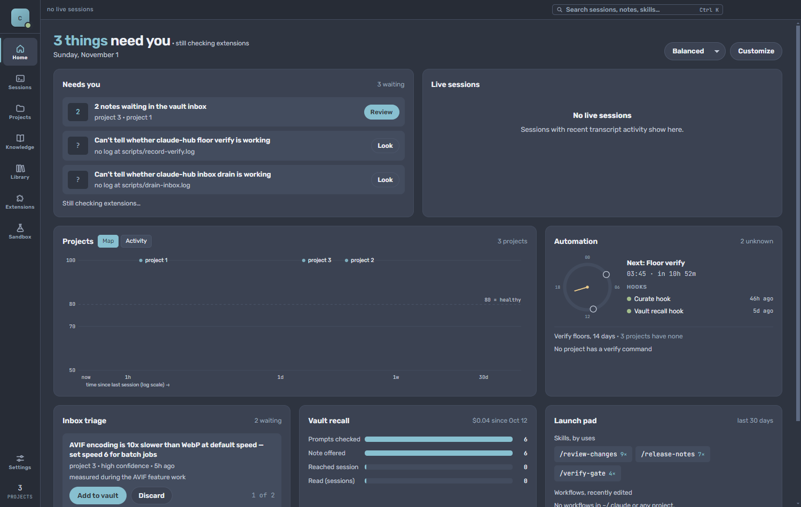
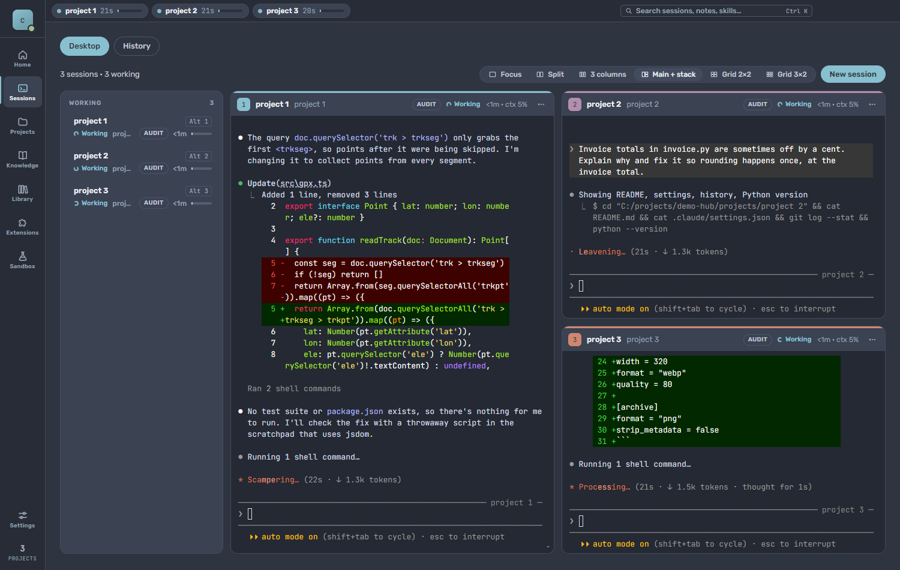
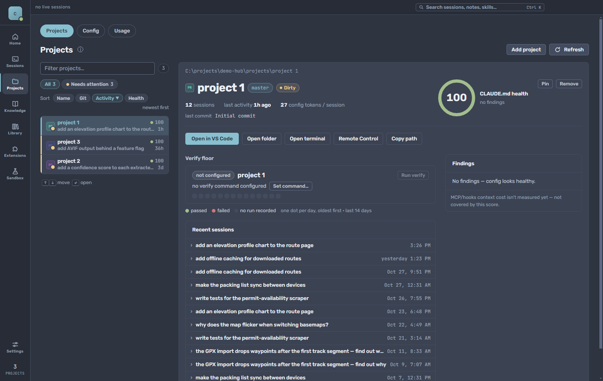
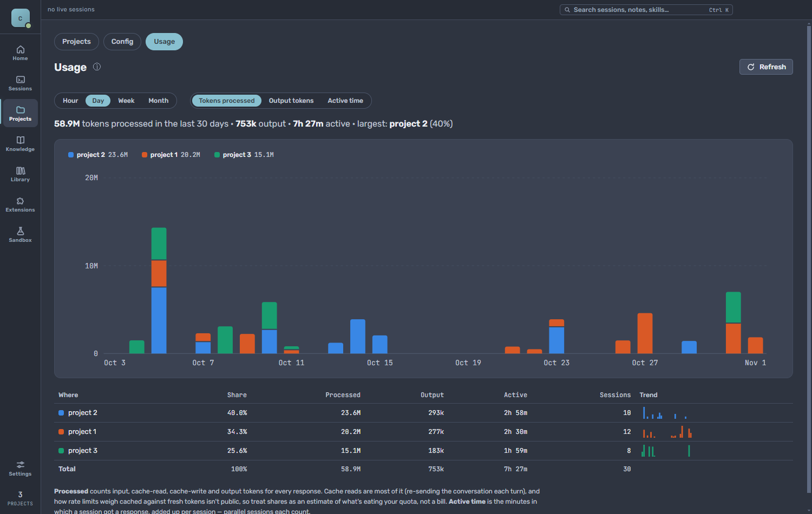
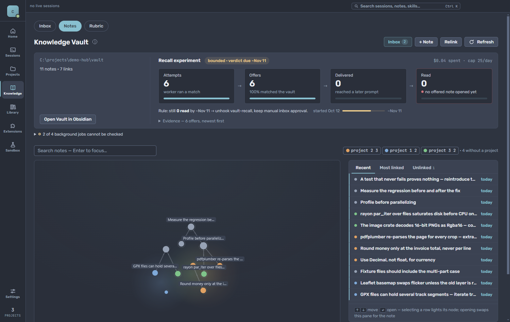

# claude-hub

A desktop control room for [Claude Code](https://claude.com/claude-code). It indexes every project
I run Claude Code in and gives me one place to see sessions, usage, project health and the
background automation. It also carries lessons from one session to the next: what a finished
session learned is captured into a shared vault and offered back to later sessions that need it.

Electron + Vite + React + TypeScript. Built for my own Windows machine, single user. I'm publishing
it as a worked example of building a tool around Claude Code, not as a supported product.



<sub>All screenshots are of the real app, run against a synthetic environment
(`scripts/demo-env.mjs`): the projects, sessions and notes are fictional.</sub>

## What it does

**Sessions.** The Desktop tab runs live Claude Code terminals side by side inside the app
(node-pty + xterm), in a host process that outlives the app, with each session's state (working,
needs you, your turn) at a glance. The History tab searches every transcript across every
registered project.



**Projects.** Git state, latest sessions, a CLAUDE.md health score (stale references, oversized
context), a per-project verify floor (lint/typecheck/test, recorded daily), and launch actions.
The Config tab manages per-project permission boundaries.



**Usage.** Tokens processed, output and active time per project, from an incremental index of the
transcripts (forked transcripts are deduplicated by response id).



**Knowledge.** The vault: plain Markdown notes in an Obsidian-compatible folder, a link graph, the
review inbox, and a scorecard that measures whether recalled notes actually get read.



Also: a skills and workflows catalog, MCP server/plugin health and usage, a sandbox for throwaway
experiments, a command palette, and a Global view that grades every hook and scheduled job on
evidence of work (log recency, failures, unfinished runs) rather than on configuration, and flags
any job whose model spend passes a weekly ceiling.

## Learning from past sessions

Claude Code sessions don't remember each other. A gotcha one session worked out, like a library
quirk or a Windows path problem, gets rediscovered from scratch in the next. claude-hub closes
that loop:


1. **Capture** ([`scripts/curate-session.mjs`](scripts/curate-session.mjs)). When a session ends, a
   hook reads its transcript. A cheap model decides whether anything is worth keeping, and only
   then does a stronger one draft a note. Drafts wait in an inbox for review; a daily job approves
   only the high-confidence ones.
2. **Recall** ([`scripts/vault-recall.mjs`](scripts/vault-recall.mjs)). When a session starts a
   task, a background worker matches it against the vault's note titles and offers up to three
   notes in a later turn, so the prompt is never held up.

Both hooks are installed globally in Claude Code, so this works across every project, not only
this one.

It's measured, not assumed: the Knowledge view tracks whether offered notes actually get opened.
Of the 11 offers that could still be checked against their transcripts, 5 were read and 4
visibly changed what the session did next, for about $11 of model calls over 84 days. Matching on
note bodies was tested too: a model shown every note's title and an excerpt of its text, for 19
sessions that got no offer, found one real miss, and its title alone would have matched. So recall
stays titles-only.

## How it's built

- **Feature slices.** `src/features/<name>/` holds a thin `index.tsx`, a `use<Name>.ts` data hook,
  and sub-components.
- **One IPC contract.** `shared/ipc-types.ts` is the single source of truth for the 100+ channels
  between main and renderer. A test checks that the handlers cover it exactly.
- **Electron-free domain code.** Main-process modules in `electron/` never import `electron`, so the
  hook scripts run the same code under plain Node.
- **Paths from enumerators, never from the renderer.** Launch and write actions resolve paths by
  registry id or against a known-good list (`electron/resolve-known-path.ts`).
- **A failure is never rendered as an absence.** Every fetch has `loading` / `error` / `data` states;
  a scan that couldn't read its input reports *unknown*, never *none*. Most of the bugs fixed here
  were a failure that showed up as an empty list.
- **Nothing steals focus.** Background jobs launch through `scripts/run-hidden.vbs`, child processes
  get `windowsHide`, and the screenshot harness renders offscreen.

[`CLAUDE.md`](CLAUDE.md) is the working brief Claude Code reads in this repo: conventions, the
security model and the background machinery. [`docs/automation.md`](docs/automation.md) documents
every hook, job and script, with the measurements behind each design decision. Some internal
working notes it refers to (session handoffs, audits) aren't part of this repository.

## Running it

Requires Windows, Node 24, and Claude Code installed and logged in.

```sh
npm install
npm run dev
```

The vault defaults to `C:\projects\claude-hub-vault`; set `CLAUDE_HUB_VAULT` to put it elsewhere.
The hooks and scheduled jobs are optional and registered by hand; `docs/automation.md` describes
each one.

Before calling a change done:

```sh
npm run lint && npm run typecheck && npm test
```

To regenerate the screenshots against the demo environment, see the header of
`scripts/demo-env.mjs`.

## License

[MIT](LICENSE)
