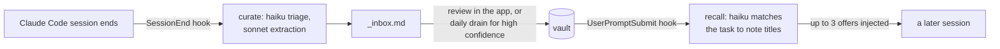

# claude-hub

A desktop control room for [Claude Code](https://claude.com/claude-code). It indexes every project
I run Claude Code in and gives me one place to see sessions, usage, project health and the
background automation. It also runs a knowledge flywheel: lessons from finished sessions are
captured into a shared vault, and offered back to new sessions that need them.

Electron + Vite + React + TypeScript. Built for my own Windows machine, single user. I'm publishing
it as a worked example of building a tool around Claude Code, not as a supported product.


<sub>All screenshots are of the real app, run against a synthetic environment
(`scripts/demo-env.mjs`): the projects, sessions and notes are fictional.</sub>

## What it does

**Sessions.** Every Claude Code transcript across every registered project, searchable, with the
conversation, tool calls and context use per session. The Desktop tab hosts live Claude Code
terminals inside the app (node-pty + xterm) in a host process that outlives the app.


**Projects.** Git state, latest sessions, a CLAUDE.md health score (stale references, oversized
context), a per-project verify floor (lint/typecheck/test, recorded daily), and launch actions.
The Config tab manages per-project permission boundaries.


**Usage.** Tokens processed, output and active time per project, from an incremental index of the
transcripts (forked transcripts are deduplicated by response id).


**Knowledge.** The vault: plain Markdown notes in an Obsidian-compatible folder, a link graph, the
review inbox, and a scorecard that measures whether recalled notes actually get read.


Also: a skills and workflows catalog, MCP server/plugin health and usage, a sandbox for throwaway
experiments, a command palette, and a Global view that grades every hook and scheduled job on
evidence of work (log recency, failures, unfinished runs) rather than on configuration.

## The knowledge flywheel



Two global hooks run in every Claude Code session on the machine, not only in this repo:

- **Curate** (`scripts/curate-session.mjs`) reads the finished transcript. A cheap triage decides
  whether anything is worth keeping; only then does an extraction pass queue candidate notes.
- **Recall** (`scripts/vault-recall.mjs`) matches the session's task against note titles in a
  detached worker, so the prompt is never blocked, and injects the matches into a later turn.

Every automation's model spend is rolled up per job, with a weekly ceiling that raises an
attention item when a job starts costing more than it should.

## How it's built

- **Feature slices.** `src/features/<name>/` holds a thin `index.tsx`, a `use<Name>.ts` data hook,
  and sub-components.
- **One IPC contract.** `shared/ipc-types.ts` is the single source of truth for the 100+ channels
  between main and renderer. A test checks that the handlers cover it exactly.
- **Electron-free domain code.** Main-process modules in `electron/` never import `electron`, so the
  hook scripts run the same code under plain Node.
- **Paths from enumerators, never from the renderer.** Launch and write actions resolve paths by
  registry id or against a known-good list (`electron/resolve-known-path.ts`).
- **A failure is never rendered as an absence.** Every fetch has `loading` / `error` / `data` states;
  a scan that couldn't read its input reports *unknown*, never *none*. Most of the bugs fixed here
  were a failure that showed up as an empty list.
- **Nothing steals focus.** Background jobs launch through `scripts/run-hidden.vbs`, child processes
  get `windowsHide`, and the screenshot harness renders offscreen.

[`CLAUDE.md`](CLAUDE.md) is the working brief Claude Code reads in this repo: conventions, the
security model and the background machinery. [`docs/automation.md`](docs/automation.md) documents
every hook, job and script, with the measurements behind each design decision. Some internal
working notes it refers to (session handoffs, audits) aren't part of this repository.

## Running it

Requires Windows, Node 24, and Claude Code installed and logged in.

```sh
npm install
npm run dev
```

The vault defaults to `C:\projects\claude-hub-vault`; set `CLAUDE_HUB_VAULT` to put it elsewhere.
The hooks and scheduled jobs are optional and registered by hand; `docs/automation.md` describes
each one.

Before calling a change done:

```sh
npm run lint && npm run typecheck && npm test
```

To regenerate the screenshots against the demo environment, see the header of
`scripts/demo-env.mjs`.

## License

[MIT](LICENSE)
